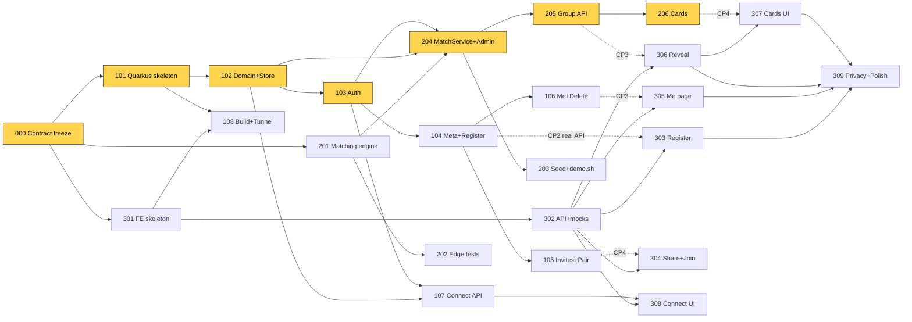

# Lunch² – Bring a Friend, Meet Two · 6-Hour Hackathon Execution Plan

> Companion file: **`docs/CONTRACTS.md`** (API, DTOs, internal interfaces, config). Both files are the law for every developer and every AI agent.
> All durations below are **estimates** (including agent interaction + verification), not guaranteed completion times.

---

## 0. Assumptions (stated, not asked)

| # | Assumption | Why |
|---|---|---|
| A1 | **Team = 3 developers.** The brief says "exactly 3" in Context/Constraints and uses owners "Developer 1, 2, 3", but "four" in several later sections. The plan is built for 3; **§F.4 gives a drop-in split if a 4th developer joins.** | Contradiction in brief; 3 is the stricter case. |
| A2 | Every laptop has JDK 21, Maven 3.9+, Node 20+, Git, and an AI coding agent. Checked at 0:00–0:10. | Environment failures are a top risk. |
| A3 | One Anthropic API key is available (Claude, model `claude-haiku-5-5` for low cost). If not → fallback cards only; no plan change. | AI is behind an interface. |
| A4 | AWS access is uncertain. Cloud deploy is **optional**; the guaranteed demo path is laptop + HTTPS tunnel (cloudflared quick tunnel) so phones can scan a QR code. | MVP must run locally. |
| A5 | "Domestic/international" is self-declared ("I've lived in Germany for a while" / "I'm new to Germany"), not nationality or ethnicity. | GDPR data minimisation, avoids Art. 9-adjacent data. |
| A6 | One matching round = each participant can be in at most one active group. This trivially guarantees "no overlapping assignments". | Simplest correct rule. |
| A7 | A friend pair is **never split by the algorithm**. If a pair can't be placed, both wait with an explained reason and get a "Match us separately" button. | Turns a soft promise into a clear, testable rule. |
| A8 | "At least one shared communication language" = one language spoken by **all four** members. | Strictest reasonable reading. |
| A9 | Judging criteria unknown → optimise for: Fit4Germany relevance, motivation for German students, working demo, UX, low cost. | Per brief. |

---

## A. Requirements Analysis

### A.1 Mandatory functional requirements
| ID | Feature | Must demonstrate |
|---|---|---|
| F1 | QR quick registration | ≤60 s form, no install, no password, secure random access token, return later |
| F2 | Bring a Friend | Share URL, friend registers via link, pair linked, kept together, explained when impossible |
| F3 | 2+2 matching | Groups of exactly 4, 2 domestic + 2 international, same campus, common slot, common language, no double assignment, friends together; unmatched users wait with a reason |
| F4 | Group reveal | Names, shared interests, date/time/location, only for members, enjoyable reveal |
| F5 | AI conversation cards | Personalised, inclusive, group language, swipe/tap UI, fallback, cached, minimal data to LLM |
| F6 | Mutual connect | Reciprocal opt-in, one-sided reveals nothing, explicit contact sharing, withdraw/decline |

### A.2 Non-functional / challenge constraints
- **GDPR/DSGVO:** minimal fields (no email, phone, nationality, age, gender, photo); purpose limitation (lunch matching only); explicit consent checkbox; per-participant access control; delete-my-data endpoint; documented retention; fictional demo data; HTTPS (tunnel/AWS give TLS).
- **Low cost:** single process (Quarkus serves the built SPA), JSON-file persistence, no background jobs, lazy + cached LLM calls with a cheap model.
- **Low friction:** mobile-first, chips instead of text fields, one screen form.
- **Reliable matching:** deterministic, validator re-checks every group, automated tests on hard constraints.
- **Privacy/human interaction:** no rankings/public profiles; one-sided requests invisible to recipient; "no" never revealed.
- **A11y & i18n:** English-first; all UI strings in `frontend/src/i18n/en.ts`; backend sends IDs not labels; WCAG AA contrast, ≥44px touch targets, labelled inputs.

### A.3 Ambiguities & how we resolved them
| Ambiguity | Decision |
|---|---|
| 3 vs 4 developers | A1 |
| "Shared language" across group or pairwise? | A8 (all four) |
| What happens when an inviter is matched before the friend registers? | Pair becomes `INCOMPATIBLE / INVITER_ALREADY_MATCHED`; friend matched individually and told why. Pending invites do **not** block the inviter. |
| When is matching triggered? | Explicit admin action (`POST /api/admin/match`, button on `#/admin`). No scheduler → no background processing. Production: cron/day-before trigger. |
| "After a meetup" for Connect | MVP allows connect once matched (so it's demoable); production gate = after `startsAt`. |
| Which contact data? | None stored at registration. Contact is free text typed **per mutual connection** at share time. |
| Repeat-match avoidance | Pairs from previous groups get a score penalty (soft). |

### A.4 Implementation risks (top 5, details in §J)
1. Matching engine correctness/time (critical path). 2. DTO drift between frontend and backend. 3. Live demo network/QR. 4. Token/auth bug blocking all authenticated screens. 5. Polishing animation before E2E works.

---

## B. MVP Definition

### B.1 Essential (simplest functional level of all six features)
| Feature | Simplest functional level we build |
|---|---|
| F1 | One-page form with chips; token returned and stored in `localStorage`; "restore link" `#/back?t=…` (token in URL fragment → never sent to server logs) |
| F2 | `POST /api/me/invite` → link + QR + Web Share/copy; `#/join/:code` landing shows inviter name; pair compatibility check at registration |
| F3 | Greedy best-scoring 2D+2I enumeration per campus/slot + validator + reason codes |
| F4 | Card-flip reveal of 4 members (CSS only), why-this-group bullets, time/place |
| F5 | Claude call → 5 JSON questions, 8 s timeout, persisted in group; deterministic fallback bank |
| F6 | Per-member YES/NO toggle; mutual → contact text box; withdraw button |

### B.2 Explicitly excluded
Real-time chat, push/e-mail notifications, admin dashboard beyond 3 buttons, university SSO, DynamoDB, Lambda, multiple matching rounds per user, editing profile after registration (delete & re-register instead), attendance check-in (optional idea only), German translation (architecture-ready only), analytics beyond one stats endpoint.

### B.3 Primary demo scenario (≈4 min)
1. **Pitch hook (30 s):** "German students already have friends. So we don't ask them to come alone — bring one. Bring a Friend, meet two."
2. Admin page: **Seed** fictional data (Würzburg + Schweinfurt, with built-in edge cases). Seed leaves **two international students (Aiko, Omar)** waiting at Würzburg Tue 12:15 — the live demo supplies the two domestic students.
3. Presenter scans QR on a projected slide → registers as **Lena (DOMESTIC, Würzburg, de/en, Tue 12:15)** in ~45 s → taps **Bring a friend** → shows QR.
4. Teammate scans it on a second phone → "Lena invited you" → registers **Sam (DOMESTIC)**.
5. Admin: **Run matching** → result shows 1 new Würzburg group (Lena, Sam, Aiko, Omar) **plus** rejected cases: Schweinfurt "Jonas waits – NOT_ENOUGH_INTERNATIONAL", cross-campus friend pair "FRIEND_DIFFERENT_CAMPUS", Turkish-only speaker "NO_COMMON_LANGUAGE".
6. Lena's phone: **group reveal** animation → 4 names, "3 of you love Travel", Mensa table, time.
7. Swipe **AI conversation cards** (badge shows "AI" or "Classic").
8. **Connect:** Lena → YES to Aiko (shows "Waiting for them" – Aiko's view reveals nothing; open Aiko's demo restore link to prove it). Lena ↔ Sam both YES → MUTUAL → Lena shares "insta @lena.w" → Sam sees it. Withdraw once to show control.
9. Close with **metrics slide** (`GET /api/admin/stats`): registration balance, match rate, mutual connections; GDPR one-pager.

---

## C. Proposed Architecture

### C.1 Stack (deliberately boring)
| Layer | Choice | Rejected alternative & why |
|---|---|---|
| Frontend | React 18 + TS + Vite + Tailwind, `react-router-dom` (HashRouter), `qrcode.react`, Vitest | Next.js – needless SSR |
| Backend | Java 21, Quarkus 3 (LTS), `quarkus-rest`, `quarkus-rest-jackson`, `quarkus-hibernate-validator`, `quarkus-junit5`, `rest-assured` | Microservices / Lambda – cold starts, more infra |
| Persistence | In-memory maps + **JSON snapshot file** behind repository interfaces | DynamoDB (IAM/infra time), JPA+SQLite (dialect friction, `@ElementCollection` for lists) |
| AI | Anthropic Messages API via JDK `java.net.http.HttpClient` (no new dependency), `claude-haiku-5-5` | LLM in matching – non-deterministic |
| Hosting | One Quarkus jar serving API **and** built SPA from `META-INF/resources` → same origin, no CORS. Demo: laptop + `cloudflared tunnel --url http://localhost:8080` (HTTPS). Optional: Docker image on AWS Lightsail Containers (eu-central-1, HTTPS endpoint included). | Amplify + API Gateway + Lambda – 3 services to configure |

### C.2 Modules & ownership
```
lunch2/
├─ AGENTS.md / CLAUDE.md            # agent rules (§K.0) – Dev 1
├─ docs/PLAN.md, docs/CONTRACTS.md  # contracts – Dev 1 (change procedure §I.3)
├─ docs/PRIVACY.md, docs/DEMO.md    # Dev 1 / Dev 2
├─ scripts/demo.sh, build-all.sh     # Dev 2
├─ backend/                          # Maven, de.thws.lunch2
│  ├─ pom.xml, application.properties               ── Dev 1 (all deps & keys pre-declared in HACK-101)
│  └─ src/main/java/de/thws/lunch2/
│     ├─ common/      ApiException, ErrorMapper, CatalogService, SlotService      ── Dev 1
│     ├─ domain/      Participant, FriendPair, Invite, LunchGroup, CardSet, ConnectionChoice, enums ── Dev 1
│     ├─ persistence/ *Repository interfaces + JsonFileStore                      ── Dev 1
│     ├─ auth/        TokenService, AuthFilter, CurrentParticipant, @Authenticated, @AdminOnly ── Dev 1
│     ├─ participant/ MetaResource, ParticipantResource, MeResource, ParticipantService, DTOs ── Dev 1
│     ├─ invite/      InviteResource, InviteService, DTOs                          ── Dev 1
│     ├─ connect/     ConnectionResource, ConnectionService, DTOs                  ── Dev 1
│     ├─ matching/    MatchCandidate, MatchingEngine, GroupValidator, MatchService ── Dev 2
│     ├─ group/       GroupResource, GroupService, DTOs                            ── Dev 2
│     ├─ cards/       CardsResource, CardService, ClaudeCardGenerator, FallbackCards ── Dev 2
│     └─ admin/       AdminResource, SeedService, StatsService; resources/seed/demo-participants.json ── Dev 2
└─ frontend/
   ├─ package.json, vite.config.ts, tailwind config                ── Dev 3
   └─ src/
      ├─ App.tsx (router, all routes pre-wired)                    ── Dev 3
      ├─ api/ client.ts, types.ts, endpoints.ts, mocks.ts, session.ts ── Dev 3
      ├─ i18n/en.ts                                                ── Dev 3 (others add keys only via own `*.strings.ts` files)
      ├─ components/ (Chip, Button, Card, Layout, QrShare, ConversationCards…) ── Dev 3
      └─ pages/ Landing, Register, Join, Restore, Me, Group, Privacy ── Dev 3 · ConnectPage ── Dev 1 · AdminPage ── Dev 2
```
**Cross-module calls allowed:** Dev 2 code may *inject* Dev 1's repositories, `CurrentParticipant`, `CatalogService`, `ApiException`. Dev 1 code never imports `matching/`, `group/`, `cards/`. Frontend pages only call `api/endpoints.ts`.

### C.3 Matching algorithm (spec for HACK-201)
1. **Pre-check friend pairs** (`friendId` set on both): different campus → both `FRIEND_DIFFERENT_CAMPUS`; no common slot → `FRIEND_NO_COMMON_SLOT`; no common language → `FRIEND_NO_COMMON_LANGUAGE`. Such candidates are excluded from this round (they wait with that reason).
2. For each campus (enum order), for each slot (chronological):
   - `pool` = unassigned candidates on that campus with that slot. Cap each category at the 40 earliest-registered (bounds enumeration ≤ 780² ≈ 600k combos).
   - Enumerate every {2 DOMESTIC} × {2 INTERNATIONAL}. **Valid** iff: all on campus, all have slot, ∩languages ≠ ∅, and for every member with a `friendId` the friend is also in the set.
   - **Score** = `10 × friendPairsInside` + `Σ pairwise |interests ∩|` × 2 + `1` if ≥3 distinct study fields + `1` if `en` or `de` in common languages − `8 × previouslyMetPairs`.
   - Pick max score; tie-break by lexicographically smallest sorted ID list (determinism). Commit, remove from pool, repeat until no valid set.
3. Every remaining candidate gets the first matching reason: (friend issue) → `NOT_ENOUGH_DOMESTIC` / `NOT_ENOUGH_INTERNATIONAL` (count by category over all their slots on campus) → `NO_COMMON_LANGUAGE` → fallback `NOT_ENOUGH_INTERNATIONAL`/`DOMESTIC` by the scarcer category.
4. `MatchService` runs `GroupValidator.violations()` on every proposed group **before** persisting; any violation → throw (never persist an invalid group).

Why not optimal (ILP/max-flow)? Greedy-with-validation is explainable, deterministic, and correct by construction; optimality isn't a hackathon requirement.

---

## D. API and Data Contracts
→ **See `docs/CONTRACTS.md`** (endpoints E1–E13, A1–A4, DTO samples, error envelope, internal Java interfaces, config keys, frontend routes). Frozen at 0:30.

---

## E. Complete Ticket Backlog

Legend: **M** = must-have, **O** = optional. Est. = minutes incl. agent + verification.

| ID | Title | Owner | Est. | Depends on | Files | Pri |
|---|---|---|---|---|---|---|
| HACK-000 | Contract review & freeze, env check, repo layout | All (Dev 1 leads) | 30 | – | docs/*, AGENTS.md, CLAUDE.md | M |
| HACK-101 | Quarkus skeleton, error envelope, all config keys | Dev 1 | 15 | 000 | backend/pom.xml, application.properties, common/ | M |
| HACK-102 | Domain classes + repository interfaces + JsonFileStore | Dev 1 | 25 | 101 | domain/, persistence/ | M |
| HACK-103 | Token service, AuthFilter, CurrentParticipant, @AdminOnly | Dev 1 | 20 | 102 | auth/ | M |
| HACK-104 | `GET /api/meta` + `POST /api/participants` | Dev 1 | 30 | 103 | participant/, common/CatalogService, SlotService | M |
| HACK-106 | `GET /api/me` + `DELETE /api/me` cascade | Dev 1 | 20 | 104 | participant/MeResource | M |
| HACK-105 | Invites, friend pair, preview, unlink | Dev 1 | 30 | 104 | invite/, participant/ParticipantService (pair hook) | M |
| HACK-107 | Mutual connect API (E10–E13) + tests | Dev 1 | 35 | 103, 102 | connect/ | M |
| HACK-308 | Connect page UI | Dev 1 | 35 | 302, 107 | frontend/src/pages/ConnectPage.tsx | M |
| HACK-110 | PRIVACY.md (retention, deletion, prod gaps) + README setup | Dev 1 | 15 | – | docs/PRIVACY.md, README.md | M |
| HACK-201 | MatchingEngine + GroupValidator (pure Java) + core tests | Dev 2 | 60 | 000 | matching/ (engine, records), test/matching/ | M |
| HACK-204 | MatchService + `POST /api/admin/match` + `/reset` | Dev 2 | 30 | 201, 102, 103 | matching/MatchService, admin/AdminResource | M |
| HACK-205 | `GET /api/groups/{id}` with membership check | Dev 2 | 20 | 204, 103 | group/ | M |
| HACK-203 | Seed dataset + `POST /api/admin/seed` + `scripts/demo.sh` | Dev 2 | 30 | 204 | admin/SeedService, resources/seed/, scripts/ | M |
| HACK-206 | Card service: fallback first, then Claude, cache in group | Dev 2 | 40 | 205 | cards/ | M (AI part degradable) |
| HACK-202 | Matching edge-case test suite | Dev 2 | 35 | 201 | test/matching/ | M |
| HACK-108 | Single-jar build (SPA in Quarkus) + tunnel demo run; optional Lightsail | Dev 2 | 35 | 101, 301 | scripts/build-all.sh, backend/src/main/docker/, docs/DEMO.md | M (tunnel) / O (AWS) |
| HACK-208 | Admin page (seed/match/reset/stats, demo links) + stats endpoint | Dev 2 | 25 | 302, 204 | pages/AdminPage.tsx, admin/StatsService | O |
| HACK-301 | Vite/TS/Tailwind skeleton, Layout, all routes + placeholder pages, i18n file | Dev 3 | 20 | 000 | frontend/* | M |
| HACK-302 | API client, types.ts, endpoints.ts (all endpoints), mocks, session | Dev 3 | 30 | 301 | frontend/src/api/ | M |
| HACK-303 | Register page (+ invite code), Landing, Restore page | Dev 3 | 40 | 302 | pages/Register, Landing, Restore; components/Chip… | M |
| HACK-305 | Me page: waiting/matched states, friend status + unlink, delete data | Dev 3 | 25 | 302 | pages/MePage.tsx | M |
| HACK-306 | Group reveal page with flip animation | Dev 3 | 40 | 302 | pages/GroupPage.tsx, components/MemberCard.tsx | M |
| HACK-304 | Bring-a-friend share sheet (QR, share, copy) + Join page | Dev 3 | 25 | 302 | components/QrShare.tsx, pages/JoinPage.tsx | M |
| HACK-307 | Conversation cards component (swipe + buttons) | Dev 3 | 25 | 306 | components/ConversationCards.tsx | M |
| HACK-309 | Privacy page, a11y + mobile polish pass | Dev 3 | 20 | 303–307 | pages/PrivacyPage.tsx, styles | M (polish part O) |

### E.1 Ticket details (description · I/O · acceptance · verification)

**HACK-000 – Contract freeze (0:00–0:30, everyone)**
Read PLAN + CONTRACTS together, challenge anything for 15 min, then freeze. Dev 1 creates folders, `.gitignore` (node_modules, target, data/), copies §K.0 into `AGENTS.md` and `CLAUDE.md`, pushes. Everyone verifies `java -version` (21), `mvn -v`, `node -v` (≥20).
*AC:* main contains docs + agent rules; each dev confirms env. *Verify:* `git pull` on all 3 laptops.

**HACK-101 – Quarkus skeleton**
Generate via code.quarkus.io / `quarkus create app de.thws.lunch2:lunch2-backend` with extensions in C.1. Add `ApiException` + `ExceptionMapper`s (ApiException, `ConstraintViolationException` → 400 `VALIDATION_FAILED` with `details`, catch-all → 500 `INTERNAL`). Declare **all** config keys of CONTRACTS §5 with defaults. `GET /api/ping` → `{"ok":true}`.
*AC:* `mvn quarkus:dev` boots on 8080; a thrown `ApiException(409,"X","msg")` returns the exact envelope. *Verify:* `mvn -q test` with one RestAssured test.

**HACK-102 – Domain + persistence**
Classes from CONTRACTS §4.1, interfaces §4.2, `JsonFileStore` (ConcurrentHashMaps, `synchronized` writes, Jackson snapshot to `lunch2.data-file` after each mutation, load on `@Startup`, create parent dir). Repository impls are thin views on the store.
*AC:* save → restart → findById returns it. *Verify:* unit test with temp file.

**HACK-103 – Auth**
`TokenService.newToken()` (32 bytes `SecureRandom`, base64url no padding), `hash()` SHA-256 hex. `AuthFilter` (`ContainerRequestFilter` bound to `@Authenticated`) reads Bearer, looks up `findByTokenHash`, fills `CurrentParticipant`, else 401 `UNAUTHORIZED`. `@AdminOnly` compares `X-Admin-Key` with constant-time equals.
*AC:* protected test endpoint → 401 without/with wrong token, 200 with valid. *Verify:* RestAssured tests.

**HACK-104 – Meta + registration**
`CatalogService` (static lists from CONTRACTS §2), `SlotService` (generate slots from config). `POST /api/participants` validates (Bean Validation on DTO + catalog membership), requires consent, creates Participant (`WAITING`, reason `WAITING_FOR_NEXT_ROUND`, `consentAt=now`), returns token once + `restoreUrl = {public-base-url}/#/back?t={token}`. Invite handling is a **hook method** `inviteService.attachIfPresent(...)` left as no-op until HACK-105.
*AC:* sample payload → 201; missing consent → 400 `CONSENT_REQUIRED`; unknown slot → 400 `UNKNOWN_SLOT`; displayName "a@b.de" → 400. *Verify:* RestAssured tests + curl.

**HACK-106 – Me + delete**
`GET /api/me` builds `MeResponse` (reason message text from a `ReasonCode → message` map in `common/`). `DELETE /api/me` cascade per CONTRACTS E4 (participant, invites, pair→friend `UNLINKED`, `ConnectionRepository.deleteByParticipant`, tombstone in groups: keep ID in `memberIds`; GroupService renders missing participant as "Former participant").
*AC:* after delete, old token → 401; friend's `/me` shows `friend: null`. *Verify:* RestAssured test.

**HACK-105 – Invites & friend pair**
E5, E6, E7 + hook from 104: on registration with code → validate, mark used, create `FriendPair`, set `friendPairId` on both, run compatibility check (A7, `INVITER_ALREADY_MATCHED`).
*AC:* full flow test: A registers → invite → B registers with code → both `/me` show `friend.displayName`; second use → 409 `INVITE_USED`; cross-campus → `INCOMPATIBLE/FRIEND_DIFFERENT_CAMPUS`; unlink → `friend:null` for both. *Verify:* RestAssured.

**HACK-107 – Mutual connect API**
E10–E13 exactly per privacy rules in CONTRACTS. Membership: caller and target both in `group.memberIds`.
*AC (tests required):* (1) A YES, B nothing → A sees `WAITING_FOR_THEM`, B sees `NONE` and `myChoice:null`; (2) A YES, B NO → A still `WAITING_FOR_THEM`; (3) both YES → `MUTUAL`; contact share before mutual → 409; after → B sees `theirContact`; (4) A switches to NO → B's `theirContact` null; (5) non-member → 403. *Verify:* `mvn test`.

**HACK-308 – Connect page (Dev 1, frontend)**
Only edits `pages/ConnectPage.tsx` (+ new `components/connect/*` if needed). Uses `endpoints.ts` functions. Per member: "I'd like to stay in touch" toggle, status chip, when MUTUAL a text field "What do you want to share? (e.g. Instagram, Discord)" + Share / Withdraw. Copy: "They'll only know if they choose you too."
*AC:* works against mocks and real backend. *Verify:* `npm run build`, manual on 375px viewport.

**HACK-110 – PRIVACY.md + README**: data inventory, purpose, legal basis assumption (consent, Art. 6(1)(a)), retention (prod: delete participant 30 days after last meetup or 90 days inactive; contacts deleted on withdraw), deletion (E4), processors (AWS eu-central-1, Anthropic – only interest IDs), and the production gap list (§J.4). README: 5-command local setup.

**HACK-201 – Matching engine (critical path)**
Implement records of CONTRACTS §4.4 and algorithm §C.3 in plain Java. `GroupValidator.violations()` checks: size 4, exactly 2/2, same campus, all have slot, ∩languages ≠ ∅, no ID twice, friend of any member present. Core tests: happy-path 2+2; friend pair placed together; validator rejects a 3+1 group.
*AC:* deterministic (same input → identical output across 3 runs); every output group has zero violations. *Verify:* `mvn -q test -Dtest='Matching*'`.

**HACK-204 – MatchService + admin match/reset**
Load `WAITING` participants, map to `MatchCandidate` (friendId only if pair `ACTIVE`), build `previouslyMetPairs` from all groups, call engine, validate, persist `LunchGroup` (location from config, `whyThisGroup` rendered with names/labels), set members `MATCHED`+`groupId`, set waiting reasons. `POST /api/admin/match` + `/reset` (`DataAdmin.wipeAll`) behind `@AdminOnly`.
*AC:* 4 compatible registrations via API → match → all `/me` show `MATCHED` and same `groupId`; running match twice creates no duplicates. *Verify:* RestAssured.

**HACK-205 – Group endpoint**: E8; 403 for non-members; no forbidden fields (test asserts JSON has no `category`, `languages` in members).

**HACK-203 – Seed + demo script**
`resources/seed/demo-participants.json` (≈18 fictional people) containing: Würzburg complete 2+2 with a DI friend pair; Würzburg Tue 12:15 **Aiko (I) + Omar (I)** left waiting for the live demo (they must NOT form a group with seed people — give other seeded Würzburg domestics different slots); Schweinfurt 3 D + 1 I (→ `NOT_ENOUGH_INTERNATIONAL`); friend pair across campuses; a `tr`-only speaker; one pair with prior shared group (repeat-penalty demo, optional). `POST /api/admin/seed` (only if demo-mode) creates them with tokens and returns restore links. `scripts/demo.sh` curls seed→match and prints links.
*AC:* fresh reset → seed → match yields exactly the planned groups and reasons (assert in a test). *Verify:* test + `./scripts/demo.sh`.

**HACK-206 – Conversation cards**
Step 1 (15 min, ship immediately): `FallbackCards` — ≥2 questions per interest + 8 generic, English + German, deterministic pick by `groupId` hash; E9 returns `FALLBACK`. Step 2: `ClaudeCardGenerator` — POST `https://api.anthropic.com/v1/messages` (headers `x-api-key`, `anthropic-version: 2023-06-01`), model from config, `max_tokens` 400, prompt: *"Write 5 friendly, inclusive lunch icebreaker questions for 4 university students (mix of locals and internationals in Germany) who share these interests: {labels}. Language: {lang}. No questions about religion, politics, health, money, family status, appearance or origin-shaming. Max 120 characters each. Reply with a JSON array of strings only."* Parse; validate 3–6 strings ≤140 chars; else fallback. Language = `en` if common else first common. Per-group `synchronized` to avoid double calls; persist `CardSet`.
*AC:* no key → FALLBACK; key → AI; second call does not hit network (log line); network failure → FALLBACK within 8 s. *Verify:* unit test with a stub generator that throws.

**HACK-202 – Edge-case tests**: insufficient participants (3) → no group + reasons; 4D+0I → none, `NOT_ENOUGH_INTERNATIONAL`; 6D+2I → exactly 1 group; incompatible slots; no shared language; friend pair different campus / no common slot; friend pair never split even when splitting would form a group; no participant in two groups across slots; determinism; previously-met penalty changes choice.
*AC:* ≥10 tests green. *Verify:* `mvn test`.

**HACK-108 – Build & demo run**: `scripts/build-all.sh` = `npm ci && npm run build` → copy `frontend/dist/*` to `backend/src/main/resources/META-INF/resources/` (git-ignored) → `mvn package` → `java -jar target/quarkus-app/quarkus-run.jar`. `docs/DEMO.md`: run tunnel, set `LUNCH2_PUBLIC_BASE_URL` to tunnel URL, print QR. Optional: Dockerfile (Quarkus `Dockerfile.jvm`) → Lightsail container service.
*AC:* phone on mobile data opens tunnel URL, registers, sees `/me`. *Verify:* real phone.

**HACK-208 – Admin page (optional)**: key input (kept in sessionStorage), buttons Seed/Match/Reset, result table incl. waiting reasons, demo restore links, stats JSON prettified.

**HACK-301 – Frontend skeleton**: `npm create vite@latest frontend -- --template react-ts`, Tailwind, install `react-router-dom`, `qrcode.react`, `vitest`. `vite.config.ts` proxy `/api → http://localhost:8080`. `App.tsx` with HashRouter and **every route of CONTRACTS §6 already pointing to its own placeholder page file** (including ConnectPage, AdminPage). `Layout` (max-w-md, mobile), `i18n/en.ts` + `t()` helper. Brand: warm yellow/ink palette, AA contrast.
*AC:* `npm run build` passes; all routes render placeholders. *Verify:* browser at 375px.

**HACK-302 – API layer**: `types.ts` mirrors CONTRACTS DTOs exactly; `client.ts` (fetch wrapper, Bearer from `session.ts`, parses error envelope into `ApiError {status, code, message, details}`); `endpoints.ts` one function per endpoint E1–E13, A1–A4; `mocks.ts` returns CONTRACTS sample payloads (with small in-memory state so register→me→group works) when `VITE_USE_MOCKS=true`.
*AC:* Vitest: client maps 409 envelope to ApiError; mocks typecheck. *Verify:* `npm test`, `npm run build`.

**HACK-303 – Register/Landing/Restore**: Landing (slogan, 3-step explainer, CTA, privacy link). Register: one scrollable form — nickname, "Which describes you?" (2 big buttons), campus (2 buttons), languages (chips), interests (chips, max 5), lunch slots (grid by day), study field (optional select), consent checkbox with link → submit → store token → `#/me` showing restore link ("Save this link to come back"). Reads `?invite=` from Join page. Inline field errors from `details`.
*AC:* complete in <60 s on phone; validation errors shown inline. *Verify:* mocks then real backend (CP2).

**HACK-305 – Me page**: WAITING state (friendly reason text from API + tip, e.g. "Add another slot"), friend card with status (incompatible → explanation + "Match us separately" → E7), "Bring a friend" CTA (opens QrShare), MATCHED → big "Reveal your lunch group" button → `#/group/:id`, "Delete my data" with confirm → E4 → clear session → Landing. No token → redirect to Landing.

**HACK-306 – Group reveal**: tap-to-reveal: 4 face-down cards flip one by one (CSS 3D, `prefers-reduced-motion` → no animation), then date/time/location card, shared interests chips, why-this-group bullets, friend badge, buttons "Conversation cards" (scroll) and "Stay in touch" → connect route.

**HACK-304 – Share & Join**: `QrShare` calls E5, shows QR of `url`, `navigator.share` if available else copy button. `JoinPage` calls E6 → "Lena invited you to lunch at Würzburg" → button to `#/register?invite=CODE`, pre-selecting campus; used/invalid → friendly message + "Register on your own".

**HACK-307 – Conversation cards**: stacked card deck, swipe (pointer events) + Next/Prev buttons (a11y), badge "AI-generated" vs "Classic", progress dots.

**HACK-309 – Privacy page & polish**: plain-language notice (what we store, why, how long, delete button pointer, fictional-data disclaimer for demo); a11y pass (labels, focus rings, contrast, 44px targets); empty/error/loading states everywhere.

---

## F. Developer Work Allocation (3 developers)

Hybrid ownership: Dev 1 = platform + identity + **Connect vertical (backend + UI)**; Dev 2 = **matching/groups/cards/admin vertical** + build/demo; Dev 3 = participant-facing frontend.

### F.1 Ordered queues
| Order | Dev 1 – Platform, Identity, Connect | Dev 2 – Matching, Groups, AI, Demo | Dev 3 – Frontend Experience |
|---|---|---|---|
| 1 | HACK-000 (lead) 0:00–0:30 | HACK-000 0:00–0:30 | HACK-000 0:00–0:30 |
| 2 | HACK-101 0:30–0:45 | **HACK-201 0:30–1:30** | HACK-301 0:30–0:50 |
| 3 | HACK-102 0:45–1:10 | HACK-204 1:30–2:00 | HACK-302 0:50–1:20 |
| 4 | HACK-103 1:10–1:30 | HACK-205 2:00–2:20 | HACK-303 1:20–2:00 |
| 5 | HACK-104 1:30–2:00 | HACK-203 2:20–2:50 | HACK-305 2:00–2:25 |
| 6 | HACK-106 2:00–2:20 | HACK-206 2:50–3:30 | HACK-306 2:25–3:05 |
| 7 | HACK-105 2:20–2:50 | HACK-202 3:30–4:05 | HACK-304 3:05–3:30 |
| 8 | HACK-107 2:50–3:25 | HACK-108 4:05–4:40 | HACK-307 3:30–3:55 |
| 9 | HACK-308 3:25–4:00 | HACK-208 (O) if time | HACK-309 3:55–4:15 |
| 10 | HACK-110 4:00–4:15, then integration/bug triage | Demo data rehearsal | Mobile bug fixing |

### F.2 Workload (excl. HACK-000)
| Dev | Must-have | Optional | Notes |
|---|---|---|---|
| Dev 1 | ~225 min | – | + merge/integration lead duties (≈15 min spread) |
| Dev 2 | ~250 min | 25 (HACK-208) | Front-loaded critical path; HACK-202 core cases already in 201 |
| Dev 3 | ~225 min | polish in 309 | Builds on mocks until CP2 → never blocked |

### F.3 Idle time & bottlenecks
- **Nobody waits at start:** Dev 2's engine is pure Java (only needs CONTRACTS §4.4); Dev 3 works on mocks; Dev 1 builds the platform others will plug into.
- **Bottleneck 1:** HACK-102/103 (Dev 1) gate Dev 2's HACK-204 at ~1:30. Dev 1 finishes 103 at ~1:30 — zero slack. *Mitigation:* Dev 1 merges 102 the moment it compiles (interfaces first, store second); Dev 2 can write 204 against interfaces with a test-local in-memory fake.
- **Bottleneck 2:** Dev 2 has the longest queue. If 201 overruns past 1:45, HACK-202 shrinks to 5 key tests and HACK-108 moves to Dev 1 (who is free at 4:15).
- Dev 1 and Dev 3 have ~15–30 min slack after 4:15 → they own bug triage and demo rehearsal.

### F.4 If a 4th developer is available
Dev 4 = "Invite & Demo" owner: takes HACK-304 + HACK-307 (from Dev 3), HACK-308 (from Dev 1), HACK-208 + HACK-108 (from Dev 2), plus pitch deck/metrics slide. Dev 1 then also owns HACK-202 support tests for connect; Dev 3 gains time for the reveal animation. File ownership moves with the tickets; no other change.

---

## G. Dependency Graph


Dashed = runtime integration only (frontend builds against mocks earlier).

**Critical path:** 000 → 101 → 102 → 103 → (201 in parallel, ~equal length) → 204 → 205 → CP3 first E2E (~2:30–2:45) → 206 → 307 → CP4 (~3:30–3:55). Slack on this path ≈ 0 between 1:10 and 2:20 — protect it (no meetings, no refactors for Dev 1/Dev 2).

**Parallel at all times:** Dev 2 engine ∥ Dev 1 platform ∥ Dev 3 UI on mocks. Cross-developer dependencies are only the five dashed integration points plus 102/103 → 204.

---

## H. Six-Hour Execution Timeline

| Time | Phase | Deliverables / checkpoint | Exit criterion |
|---|---|---|---|
| 0:00–0:30 | Plan review & freeze | HACK-000; env verified; agents primed with prompts §K | **CP0 0:30** contracts frozen, folders on main |
| 0:30–1:15 | Skeletons | Backend boots, store; FE routes + mocks; engine's first test | **CP1 1:15**: `mvn test` & `npm run build` green on main |
| 1:15–2:30 | Parallel build | Register API, auth, Me; MatchService; Register/Me pages | **CP2 2:00**: real registration from browser (mocks off) persists in JSON file |
| 2:30–3:30 | First E2E integration | Seed → match → `/me` MATCHED → reveal page shows group; invites working | **CP3 2:45**: seeded E2E on laptop browser. **CP4 3:30**: + invite flow + cards (fallback minimum) on a real phone via tunnel |
| 3:30–4:30 | Stabilise & finish | Connect UI, AI cards live, edge tests, polish, privacy page | **CP5 4:15**: full demo script runs once end-to-end. **4:30 FEATURE FREEZE** |
| 4:30–5:15 | Demo readiness | Clean reset+seed; pre-warm AI cards for demo group; backup screen recording; slides (problem, why Germans join, demo, metrics, GDPR, cost) | Recording saved; demo.sh works from clean state |
| 5:15–6:00 | Rehearsal & submission | 2 full rehearsals, README/DEMO.md final, tag `v1.0-demo`, submit | **5:00 CODE FREEZE** (only demo-breaking fixes after this, by Dev 1's call) |

**Stop-feature-development rules:** (1) After 4:30 no new UI/feature work. (2) Any ticket >50% over estimate → owner tells the lead and takes the fallback in §J immediately. (3) No animation work before CP3 has passed.

---

## I. Git and Integration Strategy

### I.1 Branching
- Trunk-based: `main` always builds. Short branches `d{n}/HACK-xxx-short-name`, one ticket per branch, lifetime ≤ 45 min.
- Merge via PR (self-merge allowed) **after** local checks: backend `mvn -q verify`, frontend `npm run build && npm test`. Rebase on `main` before merging (`git pull --rebase origin main`).
- Integration frequency: merge every finished ticket; pull `main` at least every 30 min and at every checkpoint.
- Dev 1 = integration lead: runs the checkpoint E2E, decides on reverts, owns `main` health. A red `main` is fixed or reverted within 10 min.

### I.2 File ownership rules
- Ownership per §C.2. **Never edit a file you don't own.** New files go only into your own directories.
- Pre-allocation removes the usual conflict hotspots: all Maven deps and config keys added in HACK-101; all routes and placeholder pages created in HACK-301; all endpoint functions + types created in HACK-302; `ConnectPage.tsx`/`AdminPage.tsx` ownership transfers to Dev 1/Dev 2 after 301 merges.
- Need a change in someone else's file → message the owner with the exact diff; owner applies it (≤10 min turnaround) or explicitly hands over the file.
- i18n: Dev 1/Dev 2 put strings for their pages in `pages/ConnectPage.strings.ts` / `AdminPage.strings.ts`; Dev 3 can merge them into `en.ts` later.

### I.3 Contract change procedure
1. Proposer posts the change in the team chat (field, endpoint, reason). 2. Both affected owners 👍. 3. Dev 1 edits `CONTRACTS.md` in a dedicated PR; backend owner updates DTOs, Dev 3 updates `types.ts`+mocks in the same hour. **Additive changes only after 2:30** (new optional fields), never renames.

### I.4 Conflict handling
Conflicts in owned files: owner resolves. Conflicts in generated/lock files (`package-lock.json`): take `main`'s version, re-run `npm install`, commit. Never force-push `main`.

---

## J. Risk and Fallback Plan

### J.1 Risk register
| # | Risk | P | I | Early warning | Mitigation | Fallback | Decide by |
|---|---|---|---|---|---|---|---|
| R1 | Matching engine late or buggy | M | H | 201 not green at 1:30 | Spec is fully defined; validator-first; tests with the engine | **Simplified engine:** first valid 2+2 combo (no scoring), friends-together rule kept | 2:00 |
| R2 | FE/BE DTO drift | H | M | 400/undefined fields at CP2 | Frozen contracts; mocks from sample payloads; CP2 early | Pair programming 15 min on the broken endpoint | CP2 |
| R3 | Auth bug blocks all screens | L | H | 401s at CP2 | 103 has tests; token visible in `/me` restore link | Temporary dev header is **not** allowed; fix forward with 2 devs | 2:15 |
| R4 | Live demo network / QR fails | M | H | Venue Wi-Fi flaky | Phone hotspot; tunnel tested at CP4 | Backup screen recording (made 4:30–5:15); laptop browser in mobile viewport | 4:30 |
| R5 | LLM key missing/slow/offline | M | L | 206 step 2 errors | Fallback first; 8 s timeout; cache | Fallback-only, badge "Classic" | 3:45 |
| R6 | Cloud deploy eats time | M | M | >20 min without URL | Tunnel is the default plan | Skip AWS entirely | 4:30 |
| R7 | Polish/scope creep | H | M | Animations before CP3 | Stop rules §H | Static reveal | 3:00 |
| R8 | Merge conflicts | M | M | Two people in same dir | Ownership §I.2 | Owner resolves, other rebases | always |
| R9 | Environment setup (JDK/Node) | M | H | Fails at 0:10 | Check in HACK-000 | Pair on one machine; Docker `maven:3-eclipse-temurin-21` | 0:30 |
| R10 | Data lost on restart / dirty demo state | L | M | Odd states in rehearsal | JSON snapshot; `reset`+`seed` endpoints | `demo.sh` rebuilds state in 5 s | – |

### J.2 Removable without breaking the core demo
HACK-208 admin page (use `demo.sh`), AWS deploy, flip animation (static list), swipe gestures (buttons only), AI generation (fallback), stats endpoint, repeat-match penalty, German fallback cards, Web Share API (copy link only).

### J.3 If behind schedule
- **At 2:00:** engine not green → switch to simplified engine (R1). Registration API not merged → Dev 3 stays on mocks; Dev 1 drops nothing yet but postpones HACK-106 delete part.
- **At 3:00:** no seeded E2E yet → **all hands on integration**; freeze new tickets; cards = fallback only; reveal = static; Connect UI reduced to toggle + contact field without styling.
- **At 4:00:** anything not working end-to-end is cut from the demo script; feature freeze moves to 4:00; no AWS; record the backup video at 4:30 sharp.

### J.4 GDPR – production gaps (to state honestly in the pitch & PRIVACY.md)
Prototype is **not** production-compliant. Before real use: replace bearer-token-in-localStorage with THWS SSO (Shibboleth/DFN-AAI) or e-mail magic link restricted to university addresses; rate limiting & abuse/blocking reports; privacy notice and records of processing (Art. 30) reviewed with the THWS data protection officer; DPIA screening; DPAs with AWS (EU region) and the LLM provider plus transfer assessment; automated retention deletion job; access logging policy without personal data; security review/pen-test; incident process; code of conduct for meetups.

### J.5 Real-world success metrics (pitch slide; `GET /api/admin/stats`)
Registration balance D:I, registration → match conversion, attendance (future: one-tap "We met" check-in), repeat participation, mutual connections per group, share of registrations arriving via friend invites (proves the "bring a friend" thesis for German students).

---

## Plan self-review (what we challenged and changed)

| Problem found in draft | Revision |
|---|---|
| Matching engine depended on Dev 1's `Participant` entity → Dev 2 blocked until ~1:10 | Engine takes its own `MatchCandidate` records; `MatchService` maps. Engine starts at 0:30. |
| `App.tsx`, `endpoints.ts`, `pom.xml`, `application.properties` would be edited by 3 people | Pre-allocated all routes, endpoint functions, deps, config keys in the skeleton tickets. |
| Dev 3 had ~285 min of frontend | Moved Connect UI to Dev 1 (makes Connect a full vertical slice) and admin page to Dev 2 (optional). |
| SPA deep links + CORS + two hosts | HashRouter + Quarkus serves SPA + Vite proxy → zero CORS, one deployable. |
| DynamoDB/Lambda would consume an hour of IAM/infra | JSON file store behind repositories; AWS optional at the end. |
| "Keep friends together where possible" was fuzzy and hard to test | Rule A7: never split; explain + offer unlink. Fully testable. |
| AI call at matching time = cost for unopened groups, slows matching | Lazy on first `GET /cards`, cached in group, fallback shipped first. |
| Connect "no" could leak via status | `WAITING_FOR_THEM` for both "no" and "no answer"; incoming requests hidden. |
| Integrated MVP at 3:30 vs Connect UI at 4:00 | Accepted honestly: core MVP (register→invite→match→reveal→cards) at CP4 3:30, Connect complete by 4:00 (its API is test-verified by 3:25). |
| Dev 2 is the heaviest queue | Fallbacks pre-agreed (simplified engine, 108 → Dev 1). |

---

## K. AI Coding Agent Instructions

### K.0 Shared rules — copy verbatim into `AGENTS.md` and `CLAUDE.md` (HACK-000)

```
# Lunch² agent rules (hackathon, 6h)
1. Read docs/CONTRACTS.md and the relevant ticket in docs/PLAN.md before coding. Contracts are frozen:
   never rename/remove fields, endpoints, enums, config keys. If something seems missing, STOP and report it.
2. Only create/edit files inside the directories your developer owns (PLAN.md §C.2). Never touch other owners'
   files, pom.xml/package.json/application.properties (unless you are their owner), or lock files of others.
3. Implement the simplest working solution for the current ticket only. No unrelated refactors, no speculative
   abstractions, no new dependencies (backend: JDK + Quarkus extensions already in pom; frontend: deps in package.json).
4. Backend: Java 21, package de.thws.lunch2.<module>; resources thin, logic in services; throw ApiException for
   errors; Bean Validation on request DTOs. Never log tokens, contacts or full request bodies.
5. Frontend: TypeScript strict, Tailwind, mobile-first (test at 375px), call only src/api/endpoints.ts,
   UI strings via i18n, accessible labels, 44px touch targets, respect prefers-reduced-motion.
6. Privacy: never expose tokens, categories, languages, study fields or contacts beyond what CONTRACTS.md allows.
7. Before saying "done": run `mvn -q verify` (backend) or `npm run build && npm test` (frontend) and paste the
   result summary. Never claim a check passed that you did not run.
8. Finish every task with: changed files, how to verify, open issues, anything another developer must know.
```

### K.1 Prompt – Developer 1 (Platform, Identity, Connect)

```
You are my coding agent for the Lunch² hackathon. I am Developer 1: platform, identity, invites,
mutual connect, and I am the integration lead. Follow AGENTS.md strictly.

Read docs/PLAN.md (sections C, E, I) and docs/CONTRACTS.md fully first.

My files: backend/pom.xml, backend/src/main/resources/application.properties, and backend packages
de.thws.lunch2.{common,domain,persistence,auth,participant,invite,connect} plus their tests;
frontend/src/pages/ConnectPage.tsx (+ ConnectPage.strings.ts, components/connect/*) after HACK-301 is merged;
docs/PRIVACY.md, README.md.

Work the tickets in this order, one at a time, stopping after each for me to review and merge:
HACK-101, HACK-102, HACK-103, HACK-104, HACK-106, HACK-105, HACK-107, HACK-308, HACK-110.

Key points:
- HACK-101: add ALL Quarkus extensions from PLAN §C.1 and ALL config keys from CONTRACTS §5 now,
  so nobody else must touch pom.xml or application.properties.
- HACK-102: commit the interfaces (CONTRACTS §4.2) and domain classes first so Developer 2 can code
  against them; JsonFileStore second. Single-instance JSON snapshot persistence, synchronized writes.
- HACK-103: SecureRandom 32-byte base64url tokens, store only SHA-256 hashes, @Authenticated and
  @AdminOnly name-bound filters, RequestScoped CurrentParticipant.
- HACK-104: leave a no-op hook InviteService.attachIfPresent(...) which HACK-105 fills.
- HACK-107: implement the privacy rules of CONTRACTS E10-E13 exactly and cover the 5 acceptance
  scenarios in PLAN HACK-107 with RestAssured tests.
- HACK-308: use only functions in frontend/src/api/endpoints.ts; do not edit api/ or App.tsx.
Write RestAssured tests for each endpoint ticket. Run `mvn -q verify` before reporting.
Start with HACK-101 now.
```

### K.2 Prompt – Developer 2 (Matching, Groups, AI Cards, Demo)

```
You are my coding agent for the Lunch² hackathon. I am Developer 2: matching engine, groups,
conversation cards, admin/seed/demo tooling and the demo build. Follow AGENTS.md strictly.

Read docs/PLAN.md (sections A.3, C.3, E, J) and docs/CONTRACTS.md (esp. §3 E8, E9, A1-A4, §4.4, §4.5).

My files: backend packages de.thws.lunch2.{matching,group,cards,admin} and their tests,
backend/src/main/resources/seed/, scripts/, docs/DEMO.md, backend/src/main/docker/,
frontend/src/pages/AdminPage.tsx (+ AdminPage.strings.ts) after HACK-301 is merged.
I may INJECT (not edit) Developer 1's repositories, CurrentParticipant, CatalogService, ApiException.
I must not edit pom.xml or application.properties (all keys already exist).

Tickets in order, stop after each for review/merge:
HACK-201, HACK-204, HACK-205, HACK-203, HACK-206, HACK-202, HACK-108, (optional) HACK-208.

HACK-201 is the critical path. Implement it as PURE Java (no CDI, no Quarkus, no repositories) using the
records in CONTRACTS §4.4 and exactly the algorithm in PLAN §C.3: per campus, per slot chronologically,
enumerate 2 DOMESTIC x 2 INTERNATIONAL combos, hard-constraint filter (same campus, shared slot,
a language common to all 4, friend pairs never split), score, deterministic tie-break, greedy commit,
then waiting reason codes. GroupValidator must independently re-check every hard constraint.
Write the 3 core tests from the ticket together with the engine.
If Developer 1's persistence (HACK-102) is not merged when you reach HACK-204, code against the
interfaces in CONTRACTS §4.2 with a test-local in-memory fake.
HACK-206: ship the deterministic fallback first and merge it, then add the Claude generator using JDK
HttpClient (no new dependency). Send ONLY interest labels and a language code to the AI.
Run `mvn -q verify` before reporting. Start with HACK-201 now.
```

### K.3 Prompt – Developer 3 (Frontend Experience)

```
You are my coding agent for the Lunch² hackathon. I am Developer 3: the participant-facing,
mobile-first React frontend. Follow AGENTS.md strictly.

Read docs/PLAN.md (sections B.3, C.2, E for HACK-301..309) and docs/CONTRACTS.md (all DTOs, §6 routes).

My files: everything in frontend/ EXCEPT pages/ConnectPage.tsx (Developer 1) and pages/AdminPage.tsx
(Developer 2) once HACK-301 has created their placeholders.

Tickets in order, stop after each for review/merge:
HACK-301, HACK-302, HACK-303, HACK-305, HACK-306, HACK-304, HACK-307, HACK-309.

Key points:
- HACK-301: Vite React-TS + Tailwind + react-router-dom (HashRouter) + qrcode.react + vitest.
  Proxy /api to http://localhost:8080. Create EVERY route from CONTRACTS §6 with its own placeholder
  page file now (including ConnectPage and AdminPage), so nobody else edits App.tsx.
- HACK-302: types.ts must mirror CONTRACTS.md exactly; endpoints.ts must export a typed function for
  EVERY endpoint E1-E13 and A1-A4; mocks.ts returns the CONTRACTS sample payloads with a tiny
  in-memory state, enabled by VITE_USE_MOCKS=true. Parse the error envelope into ApiError.
- Build all pages against mocks; switch to the real backend at checkpoint CP2 (~2:00).
- Product feel: fun, spontaneous, warm (not an "integration program"). Slogan "Bring a Friend. Meet Two."
  Registration must be doable in under 60 seconds on a phone: chips and big buttons, no free text
  except nickname. All strings in src/i18n/en.ts.
- Accessibility: labelled controls, visible focus, AA contrast, 44px targets, prefers-reduced-motion.
Run `npm run build && npm test` before reporting. Start with HACK-301 now.
```

### K.4 Prompt – Developer 4 (only if a 4th person joins; see §F.4)

```
You are my coding agent for the Lunch² hackathon. I am Developer 4: invite UX, conversation-card UI,
connect UI, admin page and demo build. Follow AGENTS.md strictly. Read docs/PLAN.md §F.4 and
docs/CONTRACTS.md. My files: frontend/src/components/QrShare.tsx, components/ConversationCards.tsx,
pages/JoinPage.tsx, pages/ConnectPage.tsx, pages/AdminPage.tsx, scripts/, docs/DEMO.md.
Tickets in order: HACK-304, HACK-307, HACK-308, HACK-208, HACK-108. Wait for HACK-302 (API layer)
to be merged; until then build components with props and local fixtures from CONTRACTS.md samples.
Use only frontend/src/api/endpoints.ts. Run `npm run build && npm test` before reporting.
```
