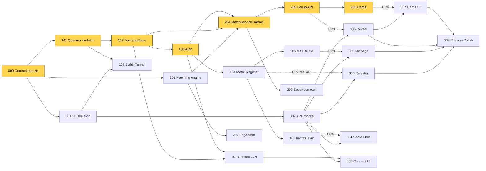

# Lunch² – Tasks, Ownership & Schedule

## HACK-111 — Play Together prototype (user-requested extension, 2026-10-29)

The user requested implementation of a post-match games hub and an icebreaker game,
including the ten supplied classic English questions alongside LLM suggestions, and
updated Markdown documentation. This narrow coordinated scope covers the required
Dev 2 cards/resource/tests and Dev 3 group page, router, game UI, mocks/tests; preserve
their existing work. It does not transfer ownership of unrelated files or features.

Acceptance: group members can open `#/group/:groupId/play` and choose Icebreakers;
non-members remain blocked by the existing API. The game combines cached `/cards`
questions with the shared classic bank for English groups, deduplicates and shuffles
locally, and supports previous/next/skip/shuffle/replay without regenerating AI content.
The other two catalog entries are clearly marked coming soon and cannot be started.
There is no attendance/time gate, XP, scoreboard, answer recording, shared game session,
polling, new dependency, new endpoint or changed wire DTO. Non-English groups retain
their shared-language deck. Old cached card sets stay intact.

Verify: Maven verify; frontend build, lint and Vitest; mobile browser checks at 375px
against mock and real APIs. Update SPEC, ARCHITECTURE, API_CONTRACT and README.

> Each developer: find your queue in §F.1, then your ticket details in §E.1. Rules: `/AGENTS.md`.

## E. Complete Ticket Backlog

Legend: **M** = must-have, **O** = optional. Est. = minutes incl. agent + verification.

| ID | Title | Owner | Est. | Depends on | Files | Pri |
|---|---|---|---|---|---|---|
| HACK-000 | Contract review & freeze, env check | All (Dev 1 leads) | 20 | – | docs/* | M (scaffold ✅ done) |
| HACK-101 | Error envelope: ApiException + exception mappers | Dev 1 | 15 | 000 | common/ | M (skeleton ✅ done) |
| HACK-102 | Domain classes + repository interfaces + JsonFileStore | Dev 1 | 25 | 101 | domain/, persistence/ | M |
| HACK-103 | Token service, AuthFilter, CurrentParticipant, @AdminOnly | Dev 1 | 20 | 102 | auth/ | M |
| HACK-104 | `GET /api/meta` + `POST /api/participants` | Dev 1 | 30 | 103 | participant/, common/CatalogService, SlotService | M |
| HACK-106 | `GET /api/me` + `DELETE /api/me` cascade | Dev 1 | 20 | 104 | participant/MeResource | M |
| HACK-105 | Invites, friend pair, preview, unlink | Dev 1 | 30 | 104 | invite/, participant/ParticipantService (pair hook) | M |
| HACK-107 | Mutual connect API (E10–E13) + tests | Dev 1 | 35 | 103, 102 | connect/ | M |
| HACK-308 | Connect page UI | Dev 1 | 35 | 302, 107 | frontend/src/pages/ConnectPage.tsx | M |
| HACK-110 | PRIVACY.md (retention, deletion, prod gaps) + README setup | Dev 1 | 15 | – | docs/PRIVACY.md, README.md | M |
| HACK-201 | MatchingEngine + GroupValidator (pure Java) + core tests | Dev 2 | 60 | 000 | matching/ (engine, records), test/matching/ | M |
| HACK-204 | MatchService + `POST /api/admin/match` + `/reset` | Dev 2 | 30 | 201, 102, 103 | matching/MatchService, admin/AdminResource | M |
| HACK-205 | `GET /api/groups/{id}` with membership check | Dev 2 | 20 | 204, 103 | group/ | M |
| HACK-203 | Seed dataset + `POST /api/admin/seed` + `scripts/demo.sh` | Dev 2 | 30 | 204 | admin/SeedService, resources/seed/, scripts/ | M |
| HACK-206 | Card service: fallback first, then Gemini, cache in group | Dev 2 | 40 | 205 | cards/ | M (AI part degradable) |
| HACK-202 | Matching edge-case test suite | Dev 2 | 35 | 201 | test/matching/ | M |
| HACK-108 | AWS deploy run + demo doc (scripts + CDK already exist) | Dev 2 | 20 | 101, 301 | scripts/, infra/, docs/DEMO.md | M |
| HACK-208 | Admin page (seed/match/reset/stats, demo links) + stats endpoint | Dev 2 | 25 | 302, 204 | pages/AdminPage.tsx, admin/StatsService | O |
| HACK-301 | Shared UI components (Button, Chip, Card) + brand styling | Dev 3 | 15 | 000 | frontend/src/components/, index.css | M (skeleton ✅ done) |
| HACK-302 | API client, types.ts, endpoints.ts (all endpoints), mocks, session | Dev 3 | 30 | 301 | frontend/src/api/ | M |
| HACK-303 | Register page (+ invite code), Landing, Restore page | Dev 3 | 40 | 302 | pages/Register, Landing, Restore; components/Chip… | M |
| HACK-305 | Me page: waiting/matched states, friend status + unlink, delete data | Dev 3 | 25 | 302 | pages/MePage.tsx | M |
| HACK-306 | Group reveal page with flip animation | Dev 3 | 40 | 302 | pages/GroupPage.tsx, components/MemberCard.tsx | M |
| HACK-304 | Bring-a-friend share sheet (QR, share, copy) + Join page | Dev 3 | 25 | 302 | components/QrShare.tsx, pages/JoinPage.tsx | M |
| HACK-307 | Conversation cards component (swipe + buttons) | Dev 3 | 25 | 306 | components/ConversationCards.tsx | M |
| HACK-309 | Privacy page, a11y + mobile polish pass | Dev 3 | 20 | 303–307 | pages/PrivacyPage.tsx, styles | M (polish part O) |

### E.1 Ticket details (description · I/O · acceptance · verification)

**HACK-000 – Contract freeze (0:00–0:20, everyone)**
Repo scaffold, `AGENTS.md`, `CLAUDE.md` and skills are already on main. Read SPEC + ARCHITECTURE + API_CONTRACT together, challenge anything for 10 min, then freeze. Everyone verifies `java -version` (21), `node -v` (≥20) and runs the README smoke commands.
*AC:* each dev has backend tests and frontend build green locally. *Verify:* README "Verify" commands on all 3 laptops.

**HACK-101 – Error envelope** *(skeleton already done: pom with all extensions, every config key of API_CONTRACT §5, `GET /api/ping`, module packages)*
Add `common/ApiException` + `ExceptionMapper`s: ApiException → its status/code/message; `ConstraintViolationException` → 400 `VALIDATION_FAILED` with `details` (field = last path node); catch-all → 500 `INTERNAL` without stack trace. Error DTOs per API_CONTRACT §1.
*AC:* a thrown `ApiException(409,"X","msg")` returns the exact envelope; an unknown exception returns 500 `INTERNAL`. *Verify:* `./mvnw -q verify` with RestAssured tests using a test-only resource.

**HACK-102 – Domain + persistence**
Classes from API_CONTRACT §4.1, interfaces §4.2, `JsonFileStore` (ConcurrentHashMaps, `synchronized` writes, Jackson snapshot to `lunch2.data-file` after each mutation, load on `@Startup`, create parent dir). Repository impls are thin views on the store.
*AC:* save → restart → findById returns it. *Verify:* unit test with temp file.

**HACK-103 – Auth**
`TokenService.newToken()` (32 bytes `SecureRandom`, base64url no padding), `hash()` SHA-256 hex. `AuthFilter` (`ContainerRequestFilter` bound to `@Authenticated`) reads Bearer, looks up `findByTokenHash`, fills `CurrentParticipant`, else 401 `UNAUTHORIZED`. `@AdminOnly` compares `X-Admin-Key` with constant-time equals.
*AC:* protected test endpoint → 401 without/with wrong token, 200 with valid. *Verify:* RestAssured tests.

**HACK-104 – Meta + registration**
`CatalogService` (static lists from API_CONTRACT §2), `SlotService` (generate slots from config). `POST /api/participants` validates (Bean Validation on DTO + catalog membership), requires consent, creates Participant (`WAITING`, reason `WAITING_FOR_NEXT_ROUND`, `consentAt=now`), returns token once + `restoreUrl = {public-base-url}/#/back?t={token}`. Invite handling is a **hook method** `inviteService.attachIfPresent(...)` left as no-op until HACK-105.
*AC:* sample payload → 201; missing consent → 400 `CONSENT_REQUIRED`; unknown slot → 400 `UNKNOWN_SLOT`; displayName "a@b.de" → 400. *Verify:* RestAssured tests + curl.

**HACK-106 – Me + delete**
`GET /api/me` builds `MeResponse` (reason message text from a `ReasonCode → message` map in `common/`). `DELETE /api/me` cascade per API_CONTRACT E4 (participant, invites, pair→friend `UNLINKED`, `ConnectionRepository.deleteByParticipant`, tombstone in groups: keep ID in `memberIds`; GroupService renders missing participant as "Former participant").
*AC:* after delete, old token → 401; friend's `/me` shows `friend: null`. *Verify:* RestAssured test.

**HACK-105 – Invites & friend pair**
E5, E6, E7 + hook from 104: on registration with code → validate, mark used, create `FriendPair`, set `friendPairId` on both, run compatibility check (A7, `INVITER_ALREADY_MATCHED`).
*AC:* full flow test: A registers → invite → B registers with code → both `/me` show `friend.displayName`; second use → 409 `INVITE_USED`; cross-campus → `INCOMPATIBLE/FRIEND_DIFFERENT_CAMPUS`; unlink → `friend:null` for both. *Verify:* RestAssured.

**HACK-107 – Mutual connect API**
E10–E13 exactly per privacy rules in API_CONTRACT. Membership: caller and target both in `group.memberIds`.
*AC (tests required):* (1) A YES, B nothing → A sees `WAITING_FOR_THEM`, B sees `NONE` and `myChoice:null`; (2) A YES, B NO → A still `WAITING_FOR_THEM`; (3) both YES → `MUTUAL`; contact share before mutual → 409; after → B sees `theirContact`; (4) A switches to NO → B's `theirContact` null; (5) non-member → 403. *Verify:* `mvn test`.

**HACK-308 – Connect page (Dev 1, frontend)**
Only edits `pages/ConnectPage.tsx` (+ new `components/connect/*` if needed). Uses `endpoints.ts` functions. Per member: "I'd like to stay in touch" toggle, status chip, when MUTUAL a text field "What do you want to share? (e.g. Instagram, Discord)" + Share / Withdraw. Copy: "They'll only know if they choose you too."
*AC:* works against mocks and real backend. *Verify:* `npm run build`, manual on 375px viewport.

**HACK-110 – PRIVACY.md + README**: data inventory, purpose, legal basis assumption (consent, Art. 6(1)(a)), retention (prod: delete participant 30 days after last meetup or 90 days inactive; contacts deleted on withdraw), deletion (E4), processors (AWS eu-central-1, Google Gemini – only interest labels and language), and the production gap list (§J.4). README: 5-command local setup.

**HACK-201 – Matching engine (critical path)**
Implement records of API_CONTRACT §4.4 and algorithm ARCHITECTURE §C.3 in plain Java. `GroupValidator.violations()` checks: size 4, exactly 2/2, same campus, all have slot, ∩languages ≠ ∅, no ID twice, friend of any member present. Core tests: happy-path 2+2; friend pair placed together; validator rejects a 3+1 group.
*AC:* deterministic (same input → identical output across 3 runs); every output group has zero violations. *Verify:* `mvn -q test -Dtest='Matching*'`.

**HACK-204 – MatchService + admin match/reset**
Load `WAITING` participants, map to `MatchCandidate` (friendId only if pair `ACTIVE`), build `previouslyMetPairs` from all groups, call engine, validate, persist `LunchGroup` (location from config, `whyThisGroup` rendered with names/labels), set members `MATCHED`+`groupId`, set waiting reasons. `POST /api/admin/match` + `/reset` (`DataAdmin.wipeAll`) behind `@AdminOnly`.
*AC:* 4 compatible registrations via API → match → all `/me` show `MATCHED` and same `groupId`; running match twice creates no duplicates. *Verify:* RestAssured.

**HACK-205 – Group endpoint**: E8; 403 for non-members; no forbidden fields (test asserts JSON has no `category`, `languages` in members).

**HACK-203 – Seed + demo script**
`resources/seed/demo-participants.json` (≈18 fictional people) containing: Würzburg complete 2+2 with a DI friend pair; Würzburg Tue 12:15 **Aiko (I) + Omar (I)** left waiting for the live demo (they must NOT form a group with seed people — give other seeded Würzburg domestics different slots); Schweinfurt 3 D + 1 I (→ `NOT_ENOUGH_INTERNATIONAL`); friend pair across campuses; a `tr`-only speaker; one pair with prior shared group (repeat-penalty demo, optional). `POST /api/admin/seed` (only if demo-mode) creates them with tokens and returns restore links. `scripts/demo.sh` curls seed→match and prints links.
*AC:* fresh reset → seed → match yields exactly the planned groups and reasons (assert in a test). *Verify:* test + `./scripts/demo.sh`.

**HACK-206 – Conversation cards**
Step 1 (15 min, ship immediately): `FallbackCards` — ≥2 questions per interest + 8 generic, English + German, deterministic pick by `groupId` hash; E9 returns `FALLBACK`.
Step 2 (provider changed to Gemini by user): `GeminiCardGenerator` — JDK HttpClient POST to `https://generativelanguage.googleapis.com/v1beta/models/{model}:generateContent`, `x-goog-api-key` header, model from config, `maxOutputTokens` 400. Send only catalog interest labels and a language code. Prompt for five friendly, inclusive lunch questions for university students; exclude religion, politics, health, money, family status, appearance and origin-shaming; request a JSON string array with questions of at most 120 characters. Validate 3–6 distinct nonblank strings ≤140 chars, normalize to five per API_CONTRACT §4.5; otherwise fallback. Overall timeout ≤8 seconds. Language = `en` if common else first common. Per-group `synchronized` to avoid double calls; persist `CardSet`.
*AC:* no key → FALLBACK; key → AI; second call does not hit network (log line); network failure → FALLBACK within 8 s. *Verify:* unit test with a stub generator that throws.

**HACK-202 – Edge-case tests**: insufficient participants (3) → no group + reasons; 4D+0I → none, `NOT_ENOUGH_INTERNATIONAL`; 6D+2I → exactly 1 group; incompatible slots; no shared language; friend pair different campus / no common slot; friend pair never split even when splitting would form a group; no participant in two groups across slots; determinism; previously-met penalty changes choice.
*AC:* ≥10 tests green. *Verify:* `mvn test`.

**HACK-108 – Build & demo run** *(done at bootstrap: `scripts/build-all.sh`, `scripts/deploy.sh`, `scripts/destroy.sh`, `infra/` CDK stack – one t3.micro + Elastic IP, port 80, secrets in SSM)*
Remaining: run `./scripts/deploy.sh` once at CP4, scan the QR with a phone on mobile data, write `docs/DEMO.md` (reset → seed → match, QR of `http://<IP>`). After every redeploy reseed the data (instance is replaced). Keep the local `build-all.sh` + `java -jar` run as the fallback.
*AC:* phone opens `http://<IP>`, registers, sees `/me`. *Verify:* real phone.

**HACK-208 – Admin page (optional)**: key input (kept in sessionStorage), buttons Seed/Match/Reset, result table incl. waiting reasons, demo restore links, stats JSON prettified.

**HACK-301 – Shared UI components** *(skeleton already done: Vite/TS/Tailwind, HashRouter with every route of API_CONTRACT §6, placeholder page per route, `Layout`, `i18n/en.ts` + `t()`, `/api` proxy, `.env.development`)*
Create `components/Button.tsx`, `Chip.tsx` (toggle chip, `aria-pressed`), `Card.tsx`, `Spinner.tsx`, `ErrorBanner.tsx`; refine brand colours in `tailwind.config.js` (AA contrast). Other pages reuse these.
*AC:* components typed, keyboard-usable, 44px targets. *Verify:* `npm run lint && npm run build`.

**HACK-302 – API layer**: `types.ts` mirrors API_CONTRACT DTOs exactly; `client.ts` (fetch wrapper, Bearer from `session.ts`, parses error envelope into `ApiError {status, code, message, details}`); `endpoints.ts` one function per endpoint E1–E13, A1–A4; `mocks.ts` returns API_CONTRACT sample payloads (with small in-memory state so register→me→group works) when `VITE_USE_MOCKS=true`.
*AC:* Vitest: client maps 409 envelope to ApiError; mocks typecheck. *Verify:* `npm test`, `npm run build`.

**HACK-303 – Register/Landing/Restore**: Landing (slogan, 3-step explainer, CTA, privacy link). Register: one scrollable form — nickname, "Which describes you?" (2 big buttons), campus (2 buttons), languages (chips), interests (chips, max 5), lunch slots (grid by day), study field (optional select), consent checkbox with link → submit → store token → `#/me` showing restore link ("Save this link to come back"). Reads `?invite=` from Join page. Inline field errors from `details`.
*AC:* complete in <60 s on phone; validation errors shown inline. *Verify:* mocks then real backend (CP2).

**HACK-305 – Me page**: WAITING state (friendly reason text from API + tip, e.g. "Add another slot"), friend card with status (incompatible → explanation + "Match us separately" → E7), "Bring a friend" CTA (opens QrShare), MATCHED → big "Reveal your lunch group" button → `#/group/:id`, "Delete my data" with confirm → E4 → clear session → Landing. No token → redirect to Landing.

**HACK-306 – Group reveal**: tap-to-reveal: 4 face-down cards flip one by one (CSS 3D, `prefers-reduced-motion` → no animation), then date/time/location card, shared interests chips, why-this-group bullets, friend badge, buttons "Conversation cards" (scroll) and "Stay in touch" → connect route.

**HACK-304 – Share & Join**: `QrShare` calls E5, shows QR of `url`, `navigator.share` if available else copy button. `JoinPage` calls E6 → "Lena invited you to lunch at Würzburg" → button to `#/register?invite=CODE`, pre-selecting campus; used/invalid → friendly message + "Register on your own".

**HACK-307 – Conversation cards**: stacked card deck, swipe (pointer events) + Next/Prev buttons (a11y), badge "AI-generated" vs "Classic", progress dots.

**HACK-309 – Privacy page & polish**: plain-language notice (what we store, why, how long, delete button pointer, fictional-data disclaimer for demo); a11y pass (labels, focus rings, contrast, 44px targets); empty/error/loading states everywhere.

---

## F. Developer Work Allocation (3 developers)

Hybrid ownership: Dev 1 = platform + identity + **Connect vertical (backend + UI)**; Dev 2 = **matching/groups/cards/admin vertical** + build/demo; Dev 3 = participant-facing frontend.

### F.1 Ordered queues
| Order | Dev 1 – Platform, Identity, Connect | Dev 2 – Matching, Groups, AI, Demo | Dev 3 – Frontend Experience |
|---|---|---|---|
| 1 | HACK-000 (lead) 0:00–0:30 | HACK-000 0:00–0:30 | HACK-000 0:00–0:30 |
| 2 | HACK-101 0:30–0:45 | **HACK-201 0:30–1:30** | HACK-301 0:30–0:50 |
| 3 | HACK-102 0:45–1:10 | HACK-204 1:30–2:00 | HACK-302 0:50–1:20 |
| 4 | HACK-103 1:10–1:30 | HACK-205 2:00–2:20 | HACK-303 1:20–2:00 |
| 5 | HACK-104 1:30–2:00 | HACK-203 2:20–2:50 | HACK-305 2:00–2:25 |
| 6 | HACK-106 2:00–2:20 | HACK-206 2:50–3:30 | HACK-306 2:25–3:05 |
| 7 | HACK-105 2:20–2:50 | HACK-202 3:30–4:05 | HACK-304 3:05–3:30 |
| 8 | HACK-107 2:50–3:25 | HACK-108 4:05–4:40 | HACK-307 3:30–3:55 |
| 9 | HACK-308 3:25–4:00 | HACK-208 (O) if time | HACK-309 3:55–4:15 |
| 10 | HACK-110 4:00–4:15, then integration/bug triage | Demo data rehearsal | Mobile bug fixing |

### F.2 Workload (excl. HACK-000)
| Dev | Must-have | Optional | Notes |
|---|---|---|---|
| Dev 1 | ~225 min | – | + merge/integration lead duties (≈15 min spread) |
| Dev 2 | ~250 min | 25 (HACK-208) | Front-loaded critical path; HACK-202 core cases already in 201 |
| Dev 3 | ~225 min | polish in 309 | Builds on mocks until CP2 → never blocked |

### F.3 Idle time & bottlenecks
- **Nobody waits at start:** Dev 2's engine is pure Java (only needs API_CONTRACT §4.4); Dev 3 works on mocks; Dev 1 builds the platform others will plug into.
- **Bottleneck 1:** HACK-102/103 (Dev 1) gate Dev 2's HACK-204 at ~1:30. Dev 1 finishes 103 at ~1:30 — zero slack. *Mitigation:* Dev 1 merges 102 the moment it compiles (interfaces first, store second); Dev 2 can write 204 against interfaces with a test-local in-memory fake.
- **Bottleneck 2:** Dev 2 has the longest queue. If 201 overruns past 1:45, HACK-202 shrinks to 5 key tests and HACK-108 moves to Dev 1 (who is free at 4:15).
- Dev 1 and Dev 3 have ~15–30 min slack after 4:15 → they own bug triage and demo rehearsal.

### F.4 If a 4th developer is available
Dev 4 = "Invite & Demo" owner: takes HACK-304 + HACK-307 (from Dev 3), HACK-308 (from Dev 1), HACK-208 + HACK-108 (from Dev 2), plus pitch deck/metrics slide. Dev 1 then also owns HACK-202 support tests for connect; Dev 3 gains time for the reveal animation. File ownership moves with the tickets; no other change.

---

## G. Dependency Graph


Dashed = runtime integration only (frontend builds against mocks earlier).

**Critical path:** 000 → 101 → 102 → 103 → (201 in parallel, ~equal length) → 204 → 205 → CP3 first E2E (~2:30–2:45) → 206 → 307 → CP4 (~3:30–3:55). Slack on this path ≈ 0 between 1:10 and 2:20 — protect it (no meetings, no refactors for Dev 1/Dev 2).

**Parallel at all times:** Dev 2 engine ∥ Dev 1 platform ∥ Dev 3 UI on mocks. Cross-developer dependencies are only the five dashed integration points plus 102/103 → 204.

---

## H. Six-Hour Execution Timeline

| Time | Phase | Deliverables / checkpoint | Exit criterion |
|---|---|---|---|
| 0:00–0:30 | Plan review & freeze | HACK-000; env verified; agents primed with kickoff prompts §K | **CP0 0:30** contracts frozen, folders on main |
| 0:30–1:15 | Skeletons | Backend boots, store; FE routes + mocks; engine's first test | **CP1 1:15**: `mvn test` & `npm run build` green on main |
| 1:15–2:30 | Parallel build | Register API, auth, Me; MatchService; Register/Me pages | **CP2 2:00**: real registration from browser (mocks off) persists in JSON file |
| 2:30–3:30 | First E2E integration | Seed → match → `/me` MATCHED → reveal page shows group; invites working | **CP3 2:45**: seeded E2E on laptop browser. **CP4 3:30**: + invite flow + cards (fallback minimum) on a real phone via tunnel |
| 3:30–4:30 | Stabilise & finish | Connect UI, AI cards live, edge tests, polish, privacy page | **CP5 4:15**: full demo script runs once end-to-end. **4:30 FEATURE FREEZE** |
| 4:30–5:15 | Demo readiness | Clean reset+seed; pre-warm AI cards for demo group; backup screen recording; slides (problem, why Germans join, demo, metrics, GDPR, cost) | Recording saved; demo.sh works from clean state |
| 5:15–6:00 | Rehearsal & submission | 2 full rehearsals, README/DEMO.md final, tag `v1.0-demo`, submit | **5:00 CODE FREEZE** (only demo-breaking fixes after this, by Dev 1's call) |

**Stop-feature-development rules:** (1) After 4:30 no new UI/feature work. (2) Any ticket >50% over estimate → owner tells the lead and takes the fallback in §J immediately. (3) No animation work before CP3 has passed.

---

## I. Git and Integration Strategy

### I.1 Branching
- Trunk-based: `main` always builds. Short branches `d{n}/HACK-xxx-short-name`, one ticket per branch, lifetime ≤ 45 min.
- Merge via PR (self-merge allowed) **after** local checks: backend `mvn -q verify`, frontend `npm run build && npm test`. Rebase on `main` before merging (`git pull --rebase origin main`).
- Integration frequency: merge every finished ticket; pull `main` at least every 30 min and at every checkpoint.
- Dev 1 = integration lead: runs the checkpoint E2E, decides on reverts, owns `main` health. A red `main` is fixed or reverted within 10 min.

### I.2 File ownership rules
- Ownership per ARCHITECTURE §C.2. **Never edit a file you don't own.** New files go only into your own directories.
- Pre-allocation removes the usual conflict hotspots: all Maven deps, config keys, routes and placeholder pages already exist in the bootstrap scaffold; all endpoint functions + types are created in HACK-302; `ConnectPage.tsx`/`AdminPage.tsx` already belong to Dev 1/Dev 2.
- Need a change in someone else's file → message the owner with the exact diff; owner applies it (≤10 min turnaround) or explicitly hands over the file.
- i18n: Dev 1/Dev 2 put strings for their pages in `pages/ConnectPage.strings.ts` / `AdminPage.strings.ts`; Dev 3 can merge them into `en.ts` later.

### I.3 Contract change procedure
1. Proposer posts the change in the team chat (field, endpoint, reason). 2. Both affected owners 👍. 3. Dev 1 edits `API_CONTRACT.md` in a dedicated PR; backend owner updates DTOs, Dev 3 updates `types.ts`+mocks in the same hour. **Additive changes only after 2:30** (new optional fields), never renames.

### I.4 Conflict handling
Conflicts in owned files: owner resolves. Conflicts in generated/lock files (`package-lock.json`): take `main`'s version, re-run `npm install`, commit. Never force-push `main`.

---

## J. Risk and Fallback Plan

### J.1 Risk register
| # | Risk | P | I | Early warning | Mitigation | Fallback | Decide by |
|---|---|---|---|---|---|---|---|
| R1 | Matching engine late or buggy | M | H | 201 not green at 1:30 | Spec is fully defined; validator-first; tests with the engine | **Simplified engine:** first valid 2+2 combo (no scoring), friends-together rule kept | 2:00 |
| R2 | FE/BE DTO drift | H | M | 400/undefined fields at CP2 | Frozen contracts; mocks from sample payloads; CP2 early | Pair programming 15 min on the broken endpoint | CP2 |
| R3 | Auth bug blocks all screens | L | H | 401s at CP2 | 103 has tests; token visible in `/me` restore link | Temporary dev header is **not** allowed; fix forward with 2 devs | 2:15 |
| R4 | Live demo network / QR fails | M | H | Venue Wi-Fi flaky | Phone hotspot; tunnel tested at CP4 | Backup screen recording (made 4:30–5:15); laptop browser in mobile viewport | 4:30 |
| R5 | LLM key missing/slow/offline | M | L | 206 step 2 errors | Fallback first; 8 s timeout; cache | Fallback-only, badge "Classic" | 3:45 |
| R6 | Cloud deploy eats time | M | M | >20 min without URL | Tunnel is the default plan | Skip AWS entirely | 4:30 |
| R7 | Polish/scope creep | H | M | Animations before CP3 | Stop rules §H | Static reveal | 3:00 |
| R8 | Merge conflicts | M | M | Two people in same dir | Ownership §I.2 | Owner resolves, other rebases | always |
| R9 | Environment setup (JDK/Node) | M | H | Fails at 0:10 | Check in HACK-000 | Pair on one machine; Docker `maven:3-eclipse-temurin-21` | 0:30 |
| R10 | Data lost on restart / dirty demo state | L | M | Odd states in rehearsal | JSON snapshot; `reset`+`seed` endpoints | `demo.sh` rebuilds state in 5 s | – |

### J.2 Removable without breaking the core demo
HACK-208 admin page (use `demo.sh`), AWS deploy, flip animation (static list), swipe gestures (buttons only), AI generation (fallback), stats endpoint, repeat-match penalty, German fallback cards, Web Share API (copy link only).

### J.3 If behind schedule
- **At 2:00:** engine not green → switch to simplified engine (R1). Registration API not merged → Dev 3 stays on mocks; Dev 1 drops nothing yet but postpones HACK-106 delete part.
- **At 3:00:** no seeded E2E yet → **all hands on integration**; freeze new tickets; cards = fallback only; reveal = static; Connect UI reduced to toggle + contact field without styling.
- **At 4:00:** anything not working end-to-end is cut from the demo script; feature freeze moves to 4:00; no AWS; record the backup video at 4:30 sharp.


## K. Kickoff prompts for each developer's AI agent

Paste the prompt for your role into your agent once, at 0:30.

### K.1 Prompt – Developer 1 (Platform, Identity, Connect)

```
You are my coding agent for the Lunch² hackathon. I am Developer 1: platform, identity, invites,
mutual connect, and I am the integration lead. Follow AGENTS.md strictly (it is auto-loaded via CLAUDE.md for Claude Code).

Read docs/ARCHITECTURE.md, docs/TASKS.md (§E, §I) and docs/API_CONTRACT.md fully first.

My files: backend/pom.xml, backend/src/main/resources/application.properties, and backend packages
de.thws.lunch2.{common,domain,persistence,auth,participant,invite,connect} plus their tests;
frontend/src/pages/ConnectPage.tsx (+ ConnectPage.strings.ts, components/connect/*) – the placeholder already exists;
docs/PRIVACY.md, README.md.

Work the tickets in this order, one at a time, stopping after each for me to review and merge:
HACK-101, HACK-102, HACK-103, HACK-104, HACK-106, HACK-105, HACK-107, HACK-308, HACK-110.

Key points:
- HACK-101: pom.xml and application.properties are already complete; only add the error envelope.
  Avoid further pom/properties changes; announce any you truly need.
- HACK-102: commit the interfaces (API_CONTRACT §4.2) and domain classes first so Developer 2 can code
  against them; JsonFileStore second. Single-instance JSON snapshot persistence, synchronized writes.
- HACK-103: SecureRandom 32-byte base64url tokens, store only SHA-256 hashes, @Authenticated and
  @AdminOnly name-bound filters, RequestScoped CurrentParticipant.
- HACK-104: leave a no-op hook InviteService.attachIfPresent(...) which HACK-105 fills.
- HACK-107: implement the privacy rules of API_CONTRACT E10-E13 exactly and cover the 5 acceptance
  scenarios in TASKS HACK-107 with RestAssured tests.
- HACK-308: use only functions in frontend/src/api/endpoints.ts; do not edit api/ or App.tsx.
Write RestAssured tests for each endpoint ticket. Run `mvn -q verify` before reporting.
Start with HACK-101 now.
```

### K.2 Prompt – Developer 2 (Matching, Groups, AI Cards, Demo)

```
You are my coding agent for the Lunch² hackathon. I am Developer 2: matching engine, groups,
conversation cards, admin/seed/demo tooling and the demo build. Follow AGENTS.md strictly (it is auto-loaded via CLAUDE.md for Claude Code).

Read docs/SPEC.md (§A.3), docs/ARCHITECTURE.md (§C.3), docs/TASKS.md (§E, §J) and docs/API_CONTRACT.md (esp. §3 E8, E9, A1-A4, §4.4, §4.5).

My files: backend packages de.thws.lunch2.{matching,group,cards,admin} and their tests,
backend/src/main/resources/seed/, scripts/, docs/DEMO.md, backend/src/main/docker/,
frontend/src/pages/AdminPage.tsx (+ AdminPage.strings.ts) – the placeholder already exists.
I may INJECT (not edit) Developer 1's repositories, CurrentParticipant, CatalogService, ApiException.
I must not edit pom.xml or application.properties (all keys already exist).

Tickets in order, stop after each for review/merge:
HACK-201, HACK-204, HACK-205, HACK-203, HACK-206, HACK-202, HACK-108, (optional) HACK-208.

HACK-201 is the critical path. Implement it as PURE Java (no CDI, no Quarkus, no repositories) using the
records in API_CONTRACT §4.4 and exactly the algorithm in ARCHITECTURE §C.3: per campus, per slot chronologically,
enumerate 2 DOMESTIC x 2 INTERNATIONAL combos, hard-constraint filter (same campus, shared slot,
a language common to all 4, friend pairs never split), score, deterministic tie-break, greedy commit,
then waiting reason codes. GroupValidator must independently re-check every hard constraint.
Write the 3 core tests from the ticket together with the engine.
If Developer 1's persistence (HACK-102) is not merged when you reach HACK-204, code against the
interfaces in API_CONTRACT §4.2 with a test-local in-memory fake.
HACK-206: ship the deterministic fallback first and merge it, then add the Gemini generator using JDK
HttpClient (no new dependency). Send ONLY interest labels and a language code to the AI.
Run `mvn -q verify` before reporting. Start with HACK-201 now.
```

### K.3 Prompt – Developer 3 (Frontend Experience)

```
You are my coding agent for the Lunch² hackathon. I am Developer 3: the participant-facing,
mobile-first React frontend. Follow AGENTS.md strictly (it is auto-loaded via CLAUDE.md for Claude Code).

Read docs/SPEC.md (§B.3), docs/ARCHITECTURE.md (§C.2), docs/TASKS.md (§E: HACK-301..309) and docs/API_CONTRACT.md (all DTOs, §6 routes).

My files: everything in frontend/ EXCEPT pages/ConnectPage.tsx (Developer 1) and pages/AdminPage.tsx
(Developer 2) once HACK-301 has created their placeholders.

Tickets in order, stop after each for review/merge:
HACK-301, HACK-302, HACK-303, HACK-305, HACK-306, HACK-304, HACK-307, HACK-309.

Key points:
- HACK-301: the skeleton (routes, placeholders, Layout, i18n, proxy) already exists; build the shared
  components only. App.tsx stays as is; never edit pages/ConnectPage.tsx or pages/AdminPage.tsx.
- HACK-302: types.ts must mirror API_CONTRACT.md exactly; endpoints.ts must export a typed function for
  EVERY endpoint E1-E13 and A1-A4; mocks.ts returns the API_CONTRACT sample payloads with a tiny
  in-memory state, enabled by VITE_USE_MOCKS=true. Parse the error envelope into ApiError.
- Build all pages against mocks; switch to the real backend at checkpoint CP2 (~2:00).
- Product feel: fun, spontaneous, warm (not an "integration program"). Slogan "Bring a Friend. Meet Two."
  Registration must be doable in under 60 seconds on a phone: chips and big buttons, no free text
  except nickname. All strings in src/i18n/en.ts.
- Accessibility: labelled controls, visible focus, AA contrast, 44px targets, prefers-reduced-motion.
Run `npm run build && npm test` before reporting. Start with HACK-301 now.
```

### K.4 Prompt – Developer 4 (only if a 4th person joins; see §F.4)

```
You are my coding agent for the Lunch² hackathon. I am Developer 4: invite UX, conversation-card UI,
connect UI, admin page and demo build. Follow AGENTS.md strictly (it is auto-loaded via CLAUDE.md for Claude Code). Read docs/TASKS.md §F.4 and
docs/API_CONTRACT.md. My files: frontend/src/components/QrShare.tsx, components/ConversationCards.tsx,
pages/JoinPage.tsx, pages/ConnectPage.tsx, pages/AdminPage.tsx, scripts/, docs/DEMO.md.
Tickets in order: HACK-304, HACK-307, HACK-308, HACK-208, HACK-108. Wait for HACK-302 (API layer)
to be merged; until then build components with props and local fixtures from API_CONTRACT.md samples.
Use only frontend/src/api/endpoints.ts. Run `npm run build && npm test` before reporting.
```

### Registration/Mensa extension — approved user scope (2026-10-29)
The user authorized a coordinated theme + registration + backend Mensa implementation,
including additive contract changes in API_CONTRACT §7. This task covers the necessary
Dev 1 catalog/registration/persistence, Dev 2 match/group integration and Dev 3 UI changes.
No new dependencies; preserve other developers' existing edits. Unimplemented unrelated
invite/connect/cards/admin features are not expanded by this task.

## HACK-309 — Animated landing and English/Deutsch (2026-10-29)

User-approved frontend extension: centered animated headlines/table, pause and
reduced-motion support; shared typed English/German dictionaries, persisted locale
selector on every page, localized catalogs/dates/known errors and reactive page
content without resetting form/session state. Integration includes existing game,
Connect and Admin strings; underlying behavior and the API contract stay intact.
Verification: frontend lint, Vitest and build; locale priority/key parity/date tests;
headline timer pause/resume/cleanup tests; mobile/desktop browser checks in both
languages, including form-state preservation.

## HACK-310 — Buddy invite API and frontend (2026-10-29)

User explicitly authorized coordinated Dev 1 invite API/tests/docs and Dev 3 frontend
implementation of the agreed buddy plan. Scope: additive optional preview Mensa/slots/
match status, share/QR/copy, join preview, inherited campus/Mensa, buddy time confirmation,
inviteCode submission, profile buddy status/unlink, localized errors, mocks and tests.
No dependency or existing-registration linking endpoint; preserve frozen existing fields.
Acceptance: invite -> buddy registration -> ACTIVE pair -> same valid 2+2 group; never
auto-select availability; used/invalid/matched invites and existing sessions explained;
unlink visible on both profiles after Refresh, existing groups unchanged. Documentation
in SPEC, ARCHITECTURE, API_CONTRACT and README updated in the same change.
Verify: frontend build/lint/Vitest, backend Maven verify, browser walkthrough.

HACK-310 verification: frontend build and lint passed; 85 Vitest tests passed with
NODE_OPTIONS=--no-experimental-global-navigator (existing English assertions otherwise
inherit the Windows German navigator locale). Backend mvnw.cmd -q verify passed:
174 tests, zero failures/errors/skips, including 13 invite tests. JAVA_HOME was set to
the installed JDK; verification ran outside sandbox after local socket/file operations
were denied inside it. Browser walkthrough remains unverified: in-app browser could
not reach localhost; Windows Computer Use stopped because it could not determine
the current browser URL confidently. Manual mobile/phone walkthrough remains.

HACK-310 follow-up — same-browser Join identity fix (2026-10-29): the previous
getToken guard hid the invite and only offered the saved participant's lunch.
Valid invitations now keep their preview and offer an explicit different-person
registration with the invite preserved, including direct register links. Buddy
registration starts with an empty nickname field. Explicit wizard navigation
handles the reordered steps; previous credentials stay active until successful
registration and a return-link control supports saving the old identity.
Regression checks cover route preservation, name-first navigation, identity choice
rendering and same-browser registration producing distinct participant IDs/tokens.
Frontend build/lint passed; 89 Vitest tests passed with the English test environment
(NODE_OPTIONS=--no-experimental-global-navigator). No backend code changed.
